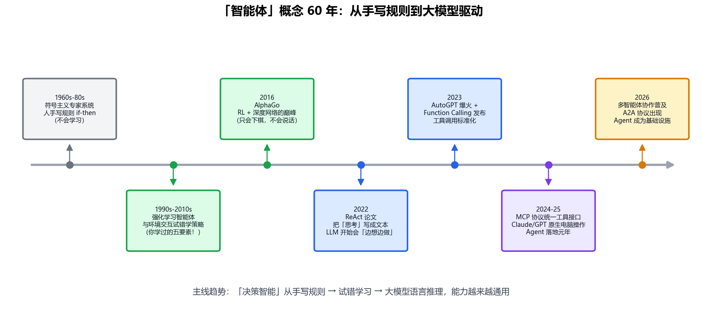
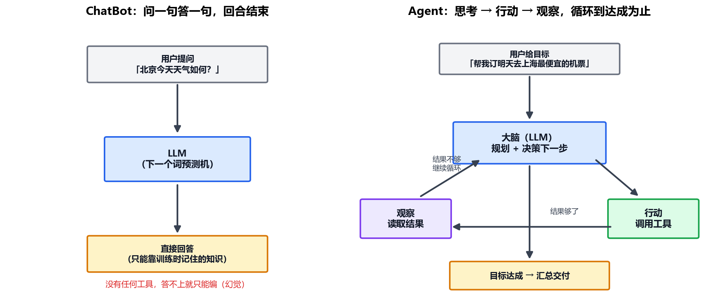
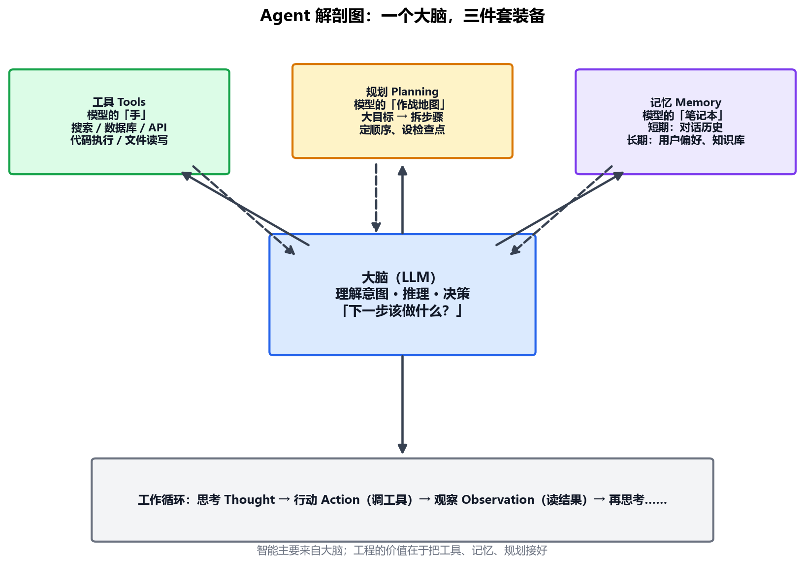
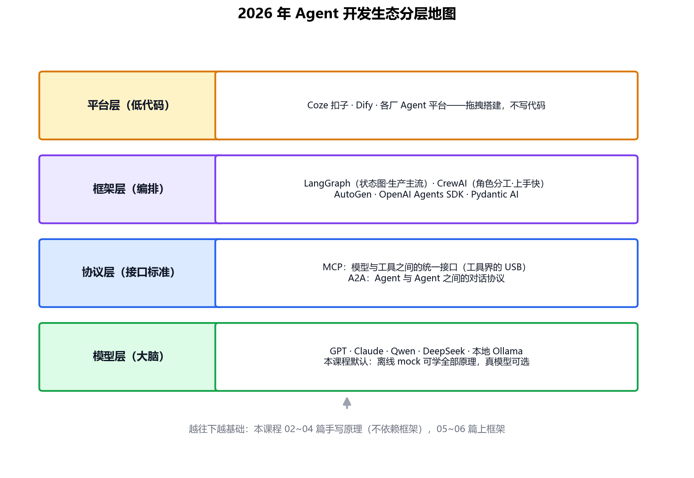

# 专题-01 - 什么是 AI Agent

## 🎯 学习目标
- 理清"智能体"概念 60 年的三波范式：手写规则 → 强化学习 → 大模型驱动
- 说清 Agent 和 ChatBot 的本质区别（有手、会拆任务、会看结果调整）
- 逐层拆解"思考 → 行动 → 观察"工作循环的每一步
- 掌握 Agent 四件套：大脑、工具、记忆、规划，及各自的工程要点
- 理解自主性光谱：从固定 workflow 到自主 Agent 到多智能体

---

## 📚 核心知识点

### 1. 背景：「智能体」这个词比大模型老 60 年

Agent（智能体）不是 2023 年才发明的新词。AI 史上,"能自己做决策的程序"经历了三波范式：



**第一波：符号主义专家系统（1960s-80s）。** 人把知识手写成的 if-then 规则库，机器按规则推理。医学诊断系统 MYCIN 是代表。致命伤：规则写不完、不会学习，稍微超出预设就抓瞎。

**第二波：强化学习智能体（1990s-2010s）。** 这就是你在《03_什么是强化学习》学过的五要素——智能体、环境、状态、动作、奖励。Agent 不再靠人写规则，而是在环境里**试错**：做动作、拿奖励、更新策略。2016 年 AlphaGo 是巅峰。但它有两个天花板：

- **专才不通才**：AlphaGo 只会下棋，换个游戏要重训；它甚至不知道自己下的东西叫"围棋"
- **不会语言**：无法理解"帮我订张机票"这种自然语言目标

**第三波：LLM 驱动的 Agent（2022 至今）。** 大模型带来了三样前两波都没有的东西：**通用语言理解**（自然语言目标直接听懂）、**零样本推理**（没专门训练过的任务也能边想边做）、**知识广度**（训练语料几乎覆盖全人类文本）。于是 Agent 的"决策核心"从手写规则、策略网络换成了 LLM——这就是本课程要学的Agent。

> 对比一下你学过的两类 Agent：
>
> | | RL Agent（AlphaGo） | LLM Agent（本课程） |
> |---|---|---|
> | 决策核心 | 策略网络 π(a|s) | LLM 的语言推理 |
> | 怎么变聪明 | 成千上万局试错训练 | 提示词 + 上下文，不用训练 |
> | 适用范围 | 单一环境（围棋=围棋） | 通用（能读懂的任务都能试） |
> | 奖励信号 | 环境显式打分 | 没有——靠"观察结果再思考"兜底 |

### 2. ChatBot vs Agent：会不会"动手"



你在 Transformer 专题 05 学过：LLM 的本质是**下一个词预测机**——给上文吐下文。ChatBot 就是拿这个能力直接对话，你问一句它答一句，**除了说话什么都不会**。更麻烦的是：它不知道的事情（今天的天气、你的日历、公司数据库）答不上来，就只能靠"语言上最像真的"去编——这就是幻觉。

Agent 的本质区别在于三点：

1. **有手（工具）**：能调搜索、数据库、代码解释器、API 去够着真实世界，而不是只靠记忆回答
2. **会拆任务（规划）**：面对"帮我订明天去上海最便宜的机票"这种复合目标，能自己拆成"查日历确认日期 → 搜航班 → 比价 → 下单"多步走
3. **会看结果调整（观察）**：工具返回了什么、成功还是失败，看完后**再决定下一步**——搜不到就换关键词，而不是一条道走到黑

一句话记忆：**ChatBot 是"问啥答啥的嘴"，Agent 是"有手有脚、会拆解任务的员工"。**

> 其实你天天在用的 Kimi Work 就是一个 Agent：你说"帮我归档到 GitHub 和 Notion"，它自己决定调 git、看提交结果、再调 Notion 接口、核对状态——这个循环就是本课程要亲手实现的东西。

### 3. 工作循环详解：思考 → 行动 → 观察

Agent 的一次任务执行，是这个循环转若干圈：

```
第 1 圈：
  思考 Thought     模型根据「目标 + 到目前为止的全部记录」决定下一步
  行动 Action      模型输出「调哪个工具、传什么参数」，程序真的去执行
  观察 Observation 工具返回结果，追加到记录里，喂回给模型
第 2 圈：模型看到了第 1 圈的结果，再思考……
……直到模型判断「信息够了/目标达成」，输出最终答案
```

三个工程细节值得现在就知道：

- **上下文在累积**：每一圈的 Thought/Action/Observation 都会拼进下一轮给模型的输入。所以上下文窗口（context window）大小直接限制 Agent 能跑多少圈——这就是"上下文工程"成为热门话题的原因
- **解析器是粘合剂**：模型输出的是文本，程序要从中可靠地提取"调哪个工具、参数是什么"——这就是专题-02 结构化输出要解决的问题
- **循环必须有刹车**：模型可能陷入死循环（反复调同一个工具）。工程上必须设最大圈数、超时、失败重试上限

### 4. 解剖 Agent：一个大脑 + 三件套装备



**🧠 大脑（LLM）——智能的来源。** 负责理解目标、推理、每一步的决策。选型时最该看的指标是**推理能力**而非聊天流畅度：一个嘴甜但不会规划的模型做不好 Agent。你在 Transformer 专题学的就是这个大脑的工作原理。

**🔧 工具（Tools）——模型的手。** LLM 本身碰不到世界，一切对外操作都封装成"工具函数"给它调。两个工程要点：

- **工具描述是写给人话看的**：模型靠读工具名 + 描述决定用不用它，描述写得差，再强的模型也会选错工具
- **参数用 JSON Schema 约束**：明确定义每个参数的类型和含义，模型照着填——专题-03 细讲

**💾 记忆（Memory）——模型的笔记本。** 分两层：

- **短期记忆** = 对话历史和任务记录，就放在上下文窗口里。窗口满了就得摘要压缩或丢弃——你在 05 章 RNN 里见过同样的"遗忘"问题，只是这里发生在 prompt 层面
- **长期记忆** = 跨会话的偏好、事实、知识，存在外部（文件、向量数据库），用时检索回来——这就是专题-04 RAG 干的事

**🗺 规划（Planning）——模型的作战地图。** 三种主流姿势，难度递增：

- **ReAct**（边想边做）：想一步做一步，最灵活，本课程 03 篇手写
- **Plan-and-Execute**（先谋后动）：先一次性列出完整计划，再逐步执行，适合步骤明确的任务
- **Reflexion**（反思）：失败后让模型复盘"刚才哪步走错了"，把教训写进记忆再试——05 篇展开

**关键认知：Agent 的"智能"主要来自大脑，工程的价值在于把另外三件接好。** 2024 年后模型本身够强，Agent 开发的重点就从"调教模型"转向"设计好工具、记忆和流程"。

### 5. ReAct：一次完整循环长什么样

ReAct（Reasoning + Acting，2022）是 Agent 的精神原型：让模型把"内心戏"写成文本，想一步做一步。一次真实（简化）的执行轨迹：

```
目标：特斯拉最近一个季度的营收是多少，同比涨了多少？

Thought: 我需要先查特斯拉最新财报数据
Action: search("Tesla Q2 2026 revenue")
Observation: 搜索返回：Tesla reported Q2 2026 revenue of $25.5B……

Thought: 有了本季度营收，还需要去年同期数据才能算同比
Action: search("Tesla Q2 2025 revenue")
Observation: 搜索返回：Q2 2025 revenue was $24.9B……

Thought: 25.5 vs 24.9，同比 = (25.5-24.9)/24.9 ≈ 2.4%，信息够了
Answer: 特斯拉 2026 Q2 营收 255 亿美元，同比增长约 2.4%。
```

注意每一步的 Thought 都在做**状态判断**："我还缺什么？"——这正是 ChatBot 没有的能力。专题-03 我们会**不用任何框架手写这个循环**，核心代码不到 50 行。

### 6. 自主性光谱：不是所有"Agent"都一样自主

业界（Anthropic 的定义流传最广）把系统分成两类：

- **Workflow（工作流）**：步骤是**人事先编好的**，模型只在个别环节填空。比如固定的"翻译 → 校对"两步流水线。可控、可预测，但不灵活
- **Agent（真智能体）**：**模型自己决定走哪条路、走几步**，人只给目标和工具箱。灵活，但不可控性也上去了

按自主性从低到高，可以画一条光谱：

```
L0 纯 ChatBot      只会对话，无工具
L1 单工具增强       会调一个工具（如搜索），一次调用就出答案
L2 多步循环 Agent   思考-行动-观察循环，自己决定调几次、调哪个 ← 本课程主战场
L3 多智能体协作     多个 Agent 分工对话（研究员+写手+审核员）   ← 06 篇
```

实践经验：**能用 workflow 解决的别上 Agent，能用单 Agent 的别上多智能体**——自主性每升一级，调试难度和翻车概率翻一倍。

### 7. 为什么 Agent 是现在爆发，而不是五年前？

四个前提 2023-2025 年才凑齐：

1. **模型推理能力过关**：2022 年前的模型做多步推理错误率太高，循环三圈就崩；GPT-4 级别之后"边想边做"才可靠
2. **Function Calling 标准化（2023）**：模型输出从"自由文本"升级到"结构化 JSON 调用"，解析器不再脆弱
3. **上下文窗口变长**：从 4K 到 128K 甚至 1M——循环积累的 Thought/Action/Observation 终于放得下了
4. **工具接口统一（MCP，2024 底）**：以前每个框架各搞一套工具格式；MCP 像 USB 一样统一了"模型 ↔ 工具"的接口，工具一次编写到处可用

### 8. 2026 年的生态地图



学这门课的路线是**先手写原理（02~04 篇），再上框架（05~06 篇）**——框架全是这层原理的封装，直接学框架容易变成"会调 API 不懂原理"。协议层（MCP/A2A）是 06 篇的主角，模型层你已经通过 Transformer 专题打好了底。

---

## 💻 本篇无代码实战

观察作业（5 分钟）：回想一次你让我做的多步任务（比如"归档到 GitHub 和 Notion"），用本篇的循环视角拆一遍：它思考了几次？调了哪些工具？每次观察到了什么？——这就是 Agent 视角。专题-03 开始动手手写这个循环。

---

## ⚠️ 常见误区

1. 以为 Agent = 更聪明的 ChatBot——错，差别在**工具调用和循环**，不在模型本身
2. 一上来就学 LangChain/LangGraph——框架封装了核心循环，先手写再封装才学得透
3. 以为 Agent 能自己保证正确——LLM 会犯错、工具会失败，**循环里必须有"观察结果再决定"的容错**，外加最大圈数刹车
4. 觉得需要训练模型才能做 Agent——绝大多数 Agent 开发是**应用工程**，不碰训练
5. 盲目追求高自主性——L2 多步循环已经覆盖 80% 实用场景，多智能体是最后才需要的

---

## 📝 小结

- 智能体三波范式：手写规则（专家系统）→ 试错学习（强化学习，你学过）→ 语言推理（LLM Agent）
- Agent = LLM（大脑）+ 工具 + 记忆 + 规划，按"思考 → 行动 → 观察"循环工作
- 与 ChatBot 的三点本质区别：有手、会拆任务、会看结果调整
- 上下文随循环累积，是 Agent 的核心资源约束；解析器和最大圈数是核心工程件
- 自主性光谱 L0→L3：能低不要高，workflow 优先于 Agent
- 爆发四前提：推理能力、Function Calling、长上下文、MCP 协议
- 下一步：专题-02，先学怎么让模型稳定输出机器可解析的结构化结果——这是一切工具调用的前提
