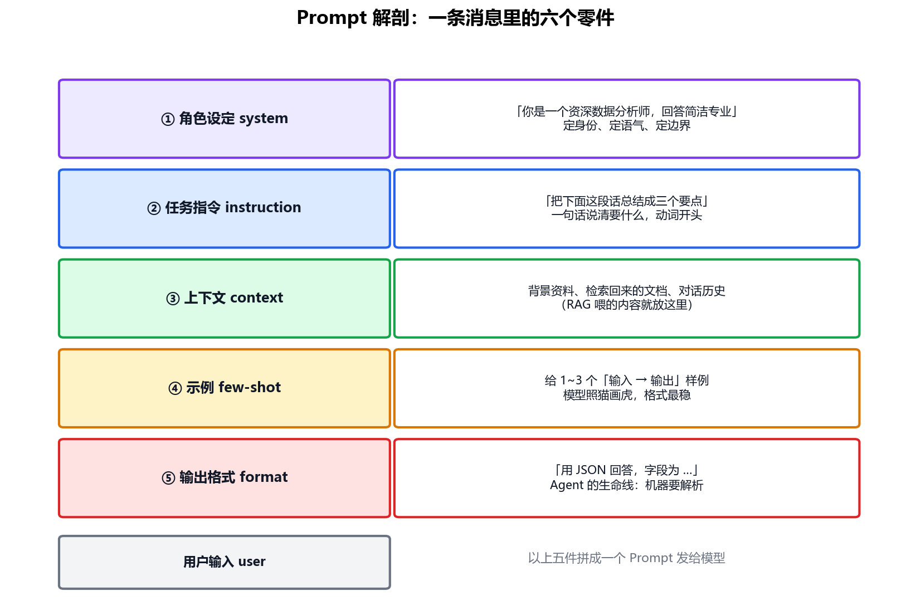

# 专题-02 - Prompt 工程与结构化输出

## 🎯 学习目标
- 理解 Prompt 是与模型交互的**唯一接口**，写 Prompt 是一门工程而非玄学
- 掌握 Prompt 的五个零件：角色、指令、上下文、示例、输出格式
- 理解 few-shot 为什么有效（联系你学过的 Transformer 原理）
- 掌握结构化输出三板斧：格式约定、JSON mode、Schema 约束，以及解析失败的兜底

---

## 📚 核心知识点

### 1. 为什么 Prompt 是"工程"

你在训练课程里学过：模型参数训练完就冻住了，使用时**唯一可调的就是输入文本**。同一个模型，Prompt 写得好与差，效果可以差出几个档次——而且 Prompt 可以版本管理、可以 A/B 测试、可以写单测。把它当代码对待，就是"工程"；把它当许愿，就是"玄学"。

对 Agent 来说 Prompt 更关键：**Agent 的每一步决策都靠 Prompt 驱动**，Prompt 里写错了工具的用法，模型就会一直错下去——没有任何梯度来纠正它。

### 2. Prompt 解剖：五个零件



**① 角色设定（system prompt）**：定身份、语气、边界。"你是资深数据分析师"不只是客套——它会显著改变模型选择词汇和推理深度的倾向。Agent 的 system prompt 通常还要写：你有哪些工具、什么情况下该用、什么情况下拒绝。

**② 任务指令（instruction）**：一句话说清要什么，**动词开头**。"总结"/"分类"/"提取"/"判断"比"帮我看看这段文字"有效得多。

**③ 上下文（context）**：背景资料。RAG（专题-04）检索回来的内容、对话历史都放在这里。原则：**模型不知道的、答对必需的，才放**——塞得越多越贵，干扰还越大。

**④ 示例（few-shot）**：给 1~3 个"输入 → 输出"样例，模型照猫画虎。这是稳定输出格式**最便宜**的手段。

**⑤ 输出格式（format）**：Agent 的生命线。模型的输出要被程序解析，格式必须像合同一样精确。

### 3. Few-shot 为什么有效？——用你学过的原理解释

你在 Transformer 专题学过：推理时没有梯度、参数不变。那给几个示例，模型怎么就"学会"了格式？

答案藏在自注意力里：示例作为**上文**进入序列，后面每个位置的注意力都能"看到"这些示例（Q 去匹配示例中的 K，取回示例的 V 里的模式）。模型在预训练时见过海量"按样例模仿"的文本模式，所以示例一摆，它就知道该续写什么格式。这叫 **in-context learning（上下文学习）**——学习发生在前向传播里，不碰参数。

推论：示例选得好不好，直接决定模仿质量。三个挑选原则：**覆盖典型情况、格式完全一致、放在靠近问题的地方**。

### 4. 结构化输出：Agent 的生命线

Agent 的程序要从模型输出里提取"调哪个工具、参数什么"。模型天生说自然语言，怎么让它稳定输出机器可解析的结果？三板斧，可靠性递增：

**板斧一：Prompt 里约定格式（最弱）**

```
请严格用以下 JSON 格式回答，不要输出任何其他文字：
{"action": "工具名", "args": {"参数名": "值"}}
```
配 few-shot 示例效果更好。缺点：模型偶尔还是会多嘴（"好的，以下是 JSON：……"），解析就崩。

**板斧二：JSON mode（中等）**

API 层面的开关（`response_format={"type": "json_object"}`），强制输出是合法 JSON。保证可解析，但**字段结构仍可能不符合你的预期**。

**板斧三：Schema 约束 / Function Calling（最强）**

把期望的结构写成 JSON Schema 交给 API，模型被约束必须按 Schema 填：

```json
{
  "name": "search",
  "description": "搜索互联网获取实时信息",
  "parameters": {
    "type": "object",
    "properties": {"q": {"type": "string", "description": "搜索关键词"}},
    "required": ["q"]
  }
}
```

这是专题-03 工具调用的正式机制。**工程原则：能用 Schema 就不用裸 Prompt 约定。**

### 5. 解析失败怎么办：校验 + 重试

就算用了最强的板斧，也要假设输出会坏。标准兜底模式：

```python
for attempt in range(3):                    # 最多重试 3 次
    raw = call_llm(prompt)
    try:
        data = json.loads(raw)              # 第一步：能解析吗
        validate(data, schema)              # 第二步：结构对吗（Pydantic/jsonschema）
        break                               # 通过，放行
    except (json.JSONDecodeError, ValidationError) as e:
        prompt += f"\n上次输出有误：{e}，请修正"   # 把错误喂回去让它改
else:
    raise AgentError("模型连续 3 次输出非法，放弃")  # 兜底失败，向上报错
```

两个要点：**错误信息喂回去**（模型看到自己的错通常能修对）、**重试必须有上限**（01 篇说的"刹车"）。

### 6. 实用技巧速查

| 技巧 | 做法 | 场景 |
|---|---|---|
| 思维链 CoT | "让我们一步步思考" | 数学/推理题，准确率明显提升 |
| 分隔符 | 用 ``` 或 <<< >>> 包裹资料 | 防止资料里的文字被当成指令 |
| 负面指令 | "不要编造、不知道就说不知道" | 抑制幻觉（配合 RAG） |
| 长度控制 | "用 3 句话以内" | 避免啰嗦，省 token |
| 先输出再解释 | 要求 JSON 在前、解释在后（或禁止解释） | 方便解析 |

---

## 💻 实战练习（agent01_json_output.py）

离线可跑：写一个 mock"模型"（故意偶尔输出坏 JSON），实现本文的「解析 → 校验 → 错误喂回 → 重试 3 次」循环：
- 观察不喂错误信息时重试成功率 vs 喂了之后的差别
- 统计 100 次调用里最终失败的比例

---

## ⚠️ 常见坑

1. Prompt 里堆礼貌用语——模型不需要"请""谢谢"，简洁明确的指令更有效
2. 用自然语言描述格式却不给示例——模型对格式的理解和你的预期十有八九不一致
3. 解析裸文本不做校验——上线第一天就会被一句"好的！"打崩
4. 重试不带上次错误——同样的错模型会原样再犯
5. 上下文贪多——无关资料会稀释注意力，又贵又容易带偏

---

## 📝 小结

- Prompt 五零件：角色、指令、上下文、示例、格式——Agent 场景里"格式"最重要
- Few-shot 的原理：示例进上下文，自注意力照猫画虎，不碰参数
- 结构化输出三板斧：格式约定 < JSON mode < Schema 约束，能用 Schema 不用裸约定
- 解析必须配「校验 + 错误喂回 + 有上限的重试」
- 下一步：专题-03，把结构化输出用在正道上——让模型决定调用哪个工具，手写 ReAct 循环
