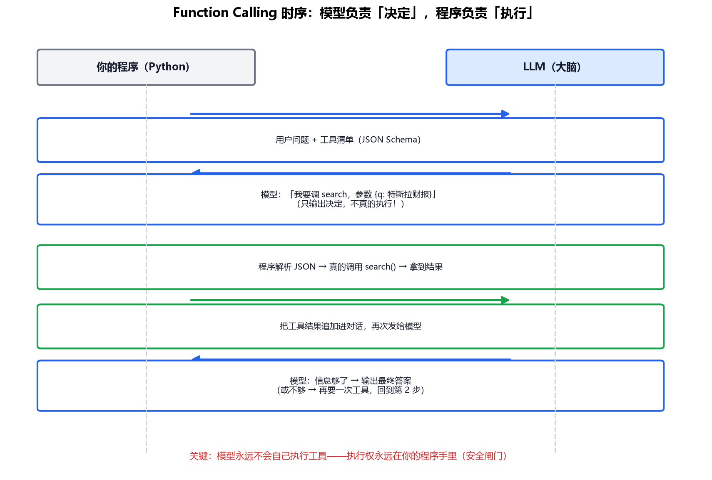

# 专题-03 - 工具调用：Function Calling 与 ReAct

## 🎯 学习目标
- 理解 Function Calling 的完整机制：模型"决定"，程序"执行"
- 会写工具描述（JSON Schema），理解描述质量为什么决定调用质量
- 不用任何框架手写一个 ReAct Agent 循环（核心 < 50 行）
- 掌握工程护栏：最大圈数、超时、错误回灌、并行调用

---

## 📚 核心知识点

### 1. 核心认知：模型永远不会自己执行工具

先破除最大的误解：**Function Calling 不是模型去调函数，而是模型"说"它想调函数**。

模型是下一个词预测机（专题 05 学透了），它能做的只有输出文本——哪怕这段文本长得像一个函数调用。真正解析这段文本、找到对应函数、执行、拿到结果的，**永远是你的程序**。这个分工是一张安全闸门：执行权在程序手里，你可以在执行前检查、拒绝、记录、限权。

### 2. 完整时序：一图看懂



对应的消息序列（简化）：

```python
messages = [
    {"role": "user", "content": "特斯拉最新季度营收多少？"},
]
# 第 1 次请求：问题 + 工具清单一起发
resp = llm(messages, tools=[search_schema, calc_schema])
# 模型返回：tool_call{name: "search", args: {"q": "Tesla Q2 2026 revenue"}}
result = search(q="Tesla Q2 2026 revenue")     # ← 你的程序真的执行
messages += [resp.tool_call_message,
             {"role": "tool", "content": result}]  # 结果追加进对话
# 第 2 次请求：模型看到结果，决定"还要查去年同期"或"信息够了"
```

注意对话是**累积**的：每轮的请求都包含之前全部消息。这就是 01 篇说的"上下文随循环累积"。

### 3. 工具描述：写给人话看的接口文档

模型选择工具的唯一依据是**工具名 + 描述 + 参数说明**（都在 JSON Schema 里）：

```python
search_schema = {
    "name": "search",
    "description": "搜索互联网获取实时信息。当问题涉及当前事件、股价、天气等训练数据之后的信息时使用。不要用于常识问题。",  # ← 边界写清楚！
    "parameters": {
        "type": "object",
        "properties": {
            "q": {"type": "string", "description": "搜索关键词，用英文效果更好"}
        },
        "required": ["q"]
    }
}
```

三个经验法则：

- **描述里写"什么时候用、什么时候别用"**——没有边界，模型会对常识题也调搜索（浪费）或对实时问题硬答（幻觉）
- **参数说明写到"模型能独立填对"的程度**——单位、格式、示例都给
- **工具要原子化**：一个工具干一件事。"查天气"和"查天气然后发邮件"应该是两个工具，组合交给模型的规划能力

### 4. 手写 ReAct 循环：核心不到 50 行

把 01 篇的循环 + 本篇的工具机制拼起来：

```python
def run_agent(goal, tools, llm, max_steps=10):
    """最小 Agent 循环：思考 → 行动 → 观察，直到出答案或撞上限。"""
    messages = [{"role": "user", "content": goal}]
    for step in range(max_steps):                    # 刹车①：最大圈数
        resp = llm(messages, tools=tools.schemas)    # 思考：模型决定下一步
        if resp.is_final_answer:                     # 模型说"信息够了"
            return resp.content
        call = resp.tool_call                        # 模型说"我要调工具"
        fn = tools.get(call.name)
        if fn is None:                               # 护栏：模型瞎编了工具名
            observation = f"错误：不存在工具 {call.name}，可用工具：{tools.names}"
        else:
            try:
                observation = fn(**call.args)        # 行动：真的执行
            except Exception as e:                   # 护栏：工具本身出错
                observation = f"工具执行失败：{e}"    # 错误也喂回，让模型想办法
        messages += [resp.message, {"role": "tool", "content": str(observation)}]  # 观察
    return "达到最大步数，任务未完成"                  # 刹车②：兜底退出
```

每个部件都对应前面学过的：结构化输出（02 篇）保证 `call.name / call.args` 能解析；错误回灌让模型看到失败可以换路；`max_steps` 是防死循环的刹车。**LangChain/LangGraph 的 Agent 本质上就是这个循环加上百个工程细节。**

### 5. 工程护栏清单

| 护栏 | 防什么 | 做法 |
|---|---|---|
| 最大圈数 | 死循环 | `max_steps=10`，撞线返回"未完成" |
| 重复检测 | 原地打转 | 同工具同参数连续出现 → 提示模型换路 |
| 工具超时 | 卡死 | 每个工具调用包 `timeout` |
| 错误回灌 | 一次失败就放弃 | 异常信息喂回，让模型重试/换工具 |
| 危险操作人审 | 删库/发钱 | 这类工具执行前暂停，等人工确认（07 篇细讲） |

### 6. 进阶：并行工具调用

模型有时一次决定要调多个**互不依赖**的工具（"查北京天气 + 查上海天气"）。现代 API 支持一次返回多个 tool_call，程序用线程池并行执行，结果一起回灌——省一整轮往返。注意：有依赖关系的（"先搜股价，再算涨幅"）必须串行，模型通常会分轮要。

### 7. 真实接口的消息，不是教学里的 `resp.tool_call`

第 4 节的循环为了短，把返回值收成了 `resp.tool_call`。DeepSeek、通义、OpenAI 兼容接口里，模型想调工具时，助手消息长这样：

```json
{
  "role": "assistant",
  "content": null,
  "tool_calls": [
    {
      "id": "call_0_0",
      "type": "function",
      "function": {
        "name": "search",
        "arguments": "{\"q\": \"Tesla revenue\"}"
      }
    }
  ]
}
```

三个容易写错的点：

- `arguments` 是**字符串**，里面才是 JSON。要再 `json.loads` 一次。有人当成对象直接用，一跑就报类型错
- 下一条必须是 `{"role": "tool", "tool_call_id": "call_0_0", "content": "工具返回的文本"}`。`tool_call_id` 对不上，模型等于没看见结果
- 并行就是 `tool_calls` 里有多项。每一项各有一个 id，回灌时逐条写 `role=tool`，id 不要串

`practice/agent02_react_loop.py` 开头会把这条消息打印出来，任务 4 是同一轮里的两个天气调用。

### 8. 什么时候不要调工具

目标缺了必填信息，就先问人。练习里的任务 5：「帮我订一张去上海的机票」没有出发城市和日期，mock 直接要补充，不调用搜索。乱填一个日期再去查，比问一句贵，而且查回来的是错的。

工具结果太长，先截断再写入上下文。练习里超过 180 字会截断并注明。把一整页网页塞回去，下一圈又贵又容易把网页里的字当成新指令（07 篇的提示注入）。

---

## 🔬 原理

### 模型没有工具注册表，它只有上下文里的那些词

程序里的函数表是给解释器用的。模型选工具时，并不去查这张表。工具名、描述、参数说明全部变成 token，拼在 \(x\) 里。下一步会不会吐出 `search` 这几个字符，取决于

\[
p(\texttt{search}\mid \text{问题}, \text{全部工具的 Schema}, \text{已有观察})
\]

和其他工具名的概率谁更大。描述和问题在注意力里对得上，这个名字的 logit 就高；对不上，概率就散到别的名字或散成一句自然语言。

由此得到三条不能靠「模型会自己明白」绕过的结论：

- 两个工具的描述如果用了同一批词，两个名字的概率会接近，采样就在两者之间翻
- 描述里没出现问题里的关键特征（「实时」「必须是数字表达式」），对应名字的概率上不去，模型就会用参数里的记忆硬答
- 名字字符串本身也是要生成的 token。模型可以发出一个列表里没有的名字。所以循环里要有「找不到这个函数」的分支，并把这句话写回上下文。不写回的话，条件不变，它还会再发同一个不存在的名字

Function Calling 能稳定，还因为聊天模型做过监督微调：在「工具清单 + 用户问题」这种版式后面，高概率续写被训练成工具调用对象，而不是散文。基座模型没有这步微调时，同一段 Prompt 的峰值可能仍是一段解释。调用格式是分布被训练推向的一种版式，不是所有语言模型的结构保证。

### 参数是再生成出来的一段文本

`arguments` 那一段同样来自 \(\prod p(y_t\mid\ldots)\)。类型信息如果只写在说明里，整数和字符串的概率都可能很高，模型会发出 `"255"` 而函数要的是数字。Schema 约束解码把不符合类型的续写掩掉。函数自己的前置条件（城市必须在表内、表达式只能含四则运算）通常写不进那张语法表，所以执行前仍然要在你的代码里拒绝，并把拒绝原因变成下一次的条件。

并行调用的原理是：模型在同一条助手消息里生成多个调用对象。这些对象之间没有「后一个看见前一个的执行结果」这层条件。因此它们只应该是互相独立的测量。有依赖的两步必须拆成两圈，让第二圈的分布条件在第一圈的观察上。

### 观察写回去，就是下一步的状态

从 01 篇的闭环看，工具返回的字符串就是测量值。它一旦进入 \(x\)，下一步的整个分布都条件在它上面。测量是错的、是一整页广告、或是藏了一句指令，控制器没有别的输入可用。截断、只保留和问题重叠的句子、用标记声明「这是数据」，都是在决定测量值以什么形式进入条件。08 篇会把「注意力权重被稀释」讲完；这里先记住：观察不是日志，是状态的一部分。

---

## 💻 实战练习（practice/agent02_react_loop.py）

```text
cd AI_Agent学习/practice
python agent02_react_loop.py
```

五个任务都在脚本里，不用改就能跑：

1. 同比：先 `search`，再 `calculator`，最后回答约 2.41%
2. `max_steps=1`：搜索完就停，返回「达到最大步数，任务未完成」
3. 工具表里拿掉计算器：模型仍然点名 calculator，程序回灌「不存在工具」，下一步改成直接回答
4. 北京和上海的天气：同一条助手消息里两个 `tool_calls`，两条 `tool_call_id` 各回各的
5. 订机票但没给日期：没有工具调用

末尾要打印「自检通过」。建议改动写在脚本顶部：一次只改一处。

---

## ⚠️ 常见坑

1. 以为模型会自己执行工具——它只输出"想调什么"，执行是你的代码
2. 工具描述只有名字没有边界——模型乱调或不敢调
3. 把工具报错直接抛异常炸掉循环——错误应该回灌给模型，它常常能自己绕过去
4. 忘记上下文累积——每轮只发最新消息，模型瞬间"失忆"
5. 一个工具包打天下——巨型工具参数复杂，模型填不对；拆小才稳

---

## 📝 小结

- Function Calling 本质：模型输出结构化的"调用意图"，程序解析并执行，结果回灌
- 工具描述是写给人话看的接口文档，边界和参数说明决定调用质量
- ReAct 循环 = 结构化输出 + 工具执行 + 错误回灌 + 最大圈数，核心 < 50 行
- 框架 = 这个循环 + 状态管理 + 可视化 + 持久化（05 篇见）
- 下一步：专题-04，给 Agent 接上"外部记忆"——RAG 检索增强

---

## 💬 自学问答

**问：教学循环里的 `resp.is_final_answer` 去哪了？**
真接口没有这个字段。没有 `tool_calls`、并且 `content` 里是给用户的话，就当作最终回答。有的实现会让模型调一个名为 `finish` 的假工具，两种都可以，项目里固定一种。

**问：参数是模型编的，执行前要不要再查一遍？**
要。Schema 校验过了再调用。城市不在允许列表、表达式里出现字母，都在你的函数里拒绝，并把拒绝原因写回 `role=tool`，不要抛到循环外面。

**问：并行调用结果回来的顺序和模型要求的不一样，要紧吗？**
要紧的是 id，不是数组顺序。每条结果带上它的 `tool_call_id`，模型按 id 对齐。

---

## 📝 小测验

1. 为什么 `arguments` 要 `json.loads` 两次（外层消息一次、这个字段再一次）？
2. 工具函数抛了异常，循环应该怎么处理？
3. 「帮我订明天最便宜的机票」还缺什么信息？这一步该不该调用搜索？
4. 工具描述写得很模糊时，模型为什么会在两个工具之间来回跳？它有没有去查你的函数表？

### 参考答案

1. 整条助手消息是一个 JSON。`arguments` 的值按接口规定是字符串，字符串里面再嵌一份 JSON。少解析一次，你拿到的字符串传不进函数。
2. 捕获它，写成「工具执行失败：…」放进 `role=tool`。这句话成为下一步的条件，分布才会离开刚才那次失败调用。练习任务 3 就是这条路径。
3. 还缺出发城市，可能还缺舱位和人数。不该搜。先问。你替用户假设一个城市再搜，返回的是另一件事。
4. 没有函数表可查。两个描述的用词接近时，两个工具名的条件概率接近，采样就在它们之间翻。描述是模型唯一能用来区分这两个名字的特征。

## 💬 我的疑问（自学时填）

| 日期 | 疑问 | 我后来怎么理解的 |
|---|---|---|
| | | |
