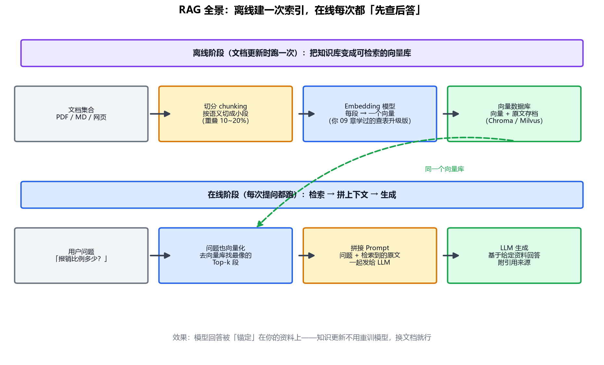

# 专题-04 - RAG 检索增强生成

## 🎯 学习目标
- 说清 RAG 解决的两个根本问题：知识截止 + 幻觉
- 掌握 RAG 全流程：离线建索引（切分 → 向量化 → 入库）与在线检索（检索 → 拼接 → 生成）
- 理解 Embedding 从词向量到句向量的升级（衔接你学过的 09 章）
- 了解进阶：混合检索、重排序、切分策略、评估指标

---

## 📚 核心知识点

### 1. 为什么需要 RAG

LLM 有两个治不好的"先天病"：

- **知识截止**：模型训练完那一刻之后的事，它一概不知。问"今天股价"，它只能编
- **幻觉**：不知道的事，它不会说"不知道"，而是编一段语言上最通顺的——你在交叉熵那章学过原因：训练目标就是"让正确词概率最高"，从没教过"承认自己不会"

还有两个现实约束：

- **私有数据**：公司制度、你的笔记，训练语料里根本没有
- **知识更新**：重训模型一次几百万美元，改文档只要几秒钟

RAG（Retrieval-Augmented Generation，检索增强生成）的思路一句话：**别指望模型背下来，让它开卷考试**——回答前先去资料库里查，把查到的原文和问题一起喂给它。

### 2. 全景流程：离线建一次，在线每次查



**离线阶段（建索引）**：文档 → 切成小段 → 每段算一个向量 → 连向量带原文存进向量数据库。文档更新时重跑。

**在线阶段（每次提问）**：问题也算一个向量 → 去库里找"最像"的几段 → 把原文拼进 Prompt → LLM 基于资料回答。

关键好处：**知识更新的成本从"重训模型"降为"换文档重算向量"**——分钟级、几乎免费。

### 3. Embedding：从词向量到句向量（复习 + 升级）

你在 09 章学过 `nn.Embedding`：词表是 (5000, 128) 的矩阵，索引 42 → 取第 42 行。那是一行**学出来的**向量——训练后语义相近的词，向量距离也近（"猫"和"狗"近，"猫"和"微积分"远）。

RAG 用的是同一思想的升级版：

- **粒度从词到段**：不再是单个词，而是整句话、整段文字 → 一个向量（768 维或更高）。用专门的 Embedding 模型（BERT 家族就是干这个出身的——专题 04 说的"encoder 做理解"在这里复活了）
- **相似度用余弦**：两个向量方向的夹角。你只关心"像不像"，不关心绝对大小

$$\text{cosine}(a, b) = \frac{a \cdot b}{\|a\| \|b\|}$$

检索 = 算问题向量与库中所有向量的余弦相似度，取 Top-k。用 PyTorch 三行：

```python
q = embed(question)                      # (1, 768)
scores = (q @ docs.T) / (q.norm() * docs.norm(dim=1))  # 余弦相似度
topk = scores.argsort(descending=True)[:k]             # 最像的 k 段
```

### 4. 切分（Chunking）：最容易被低估的环节

文档不能直接整个向量化——太长会稀释语义（一段讲十件事的向量跟谁都不像）。要切成小块，但切法讲究：

| 策略 | 做法 | 优缺点 |
|---|---|---|
| 固定长度 | 每 500 字切一刀 | 简单，但可能把一句话拦腰切断 |
| 按结构 | 按标题/段落/句号切 | 语义完整，推荐起步用 |
| 重叠窗口 | 相邻块重叠 10~20% | 防止关键句正好被切断，工程标配 |

经验值：中文每块 300~500 字、重叠 50~100 字，是大多数场景的甜区。**切分质量往往比向量模型选型更影响最终效果。**

### 5. 进阶一：混合检索——向量的盲区

向量检索有个经典盲区：**精确关键词**。搜"iPhone 17 Pro 的价格"，向量可能觉得"iPhone 16 Pro 测评"也很像（语义确实近），但用户要的是"17"这个精确型号。

解法：**混合检索 = 向量（语义像）+ BM25（关键词匹配）**，两路各自召回再合并打分。BM25 是搜索引擎用了几十年的词频统计方法，不懂语义但对精确词极其敏感。2026 年的生产 RAG 几乎都是混合检索。

### 6. 进阶二：重排序（Rerank）

向量检索求快（几百万段里毫秒级返回），用的相似度比较粗。工业做法是**两段式**：

1. **召回**：向量 + BM25 粗筛出 50 段（快但糙）
2. **重排**：用一个更精细的模型（cross-encoder，它同时看问题和段落再打分，比分别向量化准得多）把 50 段精排，取前 5 段喂给 LLM

类比：召回是简历初筛（快、看关键词），重排是面试（慢、看得准）。

### 7. 怎么知道 RAG 好不好用

两类指标分开看：

- **检索质量**：命中率——正确段落是否出现在 Top-k 里（检索不行，生成再强也白搭）
- **生成质量**：忠实度——回答的每句话是否能追溯到检索回来的原文（防"给了资料还瞎编"）

评估框架有 RAGAS 等，07 篇讲评测时再展开。

### 8. RAG 在 Agent 里的位置

回到 01 篇的四件套：**RAG 就是"长期记忆"的标准实现**。在 Agent 架构里，它通常被封装成一个工具（`search_knowledge_base`），模型自己决定"这个问题要不要查资料"——把 03 篇的工具调用和本篇的检索拼起来，就是一个能查私有知识的 Agent。

### 9. 向量和关键词会各看走眼一次

练习里的向量故意把数字换成 `#`，用来模仿「语义很像、但型号错了」。问「iPhone 17 Pro 的价格」时：

- 向量第一名是「iPhone 16 Pro 的价格：7999 元」。两条在抹掉数字后都像「iPhone # Pro」，而 16 那条正文里正好有「的价格」，夹角更小
- 关键词第一名是「iPhone 17 Pro 官方售价 8999 元」。它给数字整词更高的权重，`17` 对上了
- 混合把两路加起来之后，第一名回到 17 的售价

真 Embedding 模型不会真的把数字删掉，但精确型号、错误码、人名，仍然是向量检索常见的盲区。所以生产系统几乎都加一路关键词。

还有一个评分陷阱：如果把每一路分数做 min-max，最高的那个永远变成 1。库里根本没有答案时，第一名也是「满分」。练习里的拒答不看这种归一化，看的是绝对分，以及第一名是否比第二名明显高。

### 10. 查不查、怎么改写、不够就停

把检索封装成工具之后，多出来三步，仍然是 03 篇的循环：

1. 模型决定要不要查。闲聊不必查
2. 第一次最高分没有把握，就改写查询再查一次。练习里「病假怎么开」会改写成「病假 请假 休假 假期 制度」
3. 改写后仍然分不清第一名，就回答「资料里没有，我不知道」。不要退回模型的记忆去编

病假不在那 10 条制度里。改写后若干条都沾上「制度」两个字，第一名并不领先，所以练习输出「我不知道」。年假在库里，直接命中「满一年 5 天…」。

---

## 🔬 原理

### 句向量是怎么来的，为什么方向代表「像」

检索用的 Embedding 模型大多是一个 Transformer。一段文字进去，最后一层给出每个 token 的隐藏状态 \(h_i\)。句向量通常是这些状态的池化：取第一个特殊位置，或做平均

\[
v = \frac{1}{n}\sum_{i=1}^{n} h_i
\]

训练目标常常是对比损失。一批里有匹配的问题—文档 \((q, d^+)\)，也有不匹配的 \(d^-\)。用和交叉熵同形的式子，让匹配的那一对在 softmax 里胜出：

\[
\mathcal{L} = -\log \frac{\exp(\mathrm{sim}(q,d^+)/\tau)}{\sum_j \exp(\mathrm{sim}(q,d_j)/\tau)}
\]

\(\mathrm{sim}\) 用余弦或点积。你学过的交叉熵是「在类别上做对」；这里类别临时变成「这一批里的文档」。训完之后，语义相近的文本方向靠近，是因为靠近才会让正样本的那一项变大。推理时按余弦排序，就是在用训练时的那个相似度。

\(\tau\) 是这个 softmax 的温度。它小，模型必须把正样本拉得很近、把负样本推开，区分更挑剔；它大，区分变松。

余弦不管长度，只看夹角，所以两段文字谁的向量模更大不会直接决定排名。但这些分数不是概率：不同问题之间的 0.8 不能拿来比。对比学习会把挤在一起的表示拉开一些，绝对分仍然随问题和语料变。所以「超过 0.8 就采信」没有通用含义。练习里改用「第一名是否比第二名明显高」，就是在避开把原始分当成概率。

### 切分为什么会决定效果：平均把主题冲淡了

设一段里只有 \(h_1\) 和问题相关，其余 \(n-1\) 个状态是别的话题。平均之后和问题向量 \(q\) 的点积是

\[
q\cdot v = \frac{1}{n} q\cdot h_1 + \frac{1}{n}\sum_{i=2}^{n} q\cdot h_i
\]

相关的那一项被 \(1/n\) 缩小，不相关的项还在往边上看。\(n\) 大到一段里塞了十件事时，\(v\) 跟哪一件都不像，检索就会「什么都有点像」。按主题切开，是在让每个 \(v\) 的平均里不要混进太多无关的 \(h_i\)。重叠窗口则是为了避免关键句正好被切在两段里，两段的平均都只含半句。

这和换一个更大的 Embedding 模型不是同一层。模型决定 \(h_i\) 的质量；切分决定你拿去平均的是哪些 \(h_i\)。

### 双编码器看不见词和词的对照，所以型号会糊

上面的做法叫**双编码器**：问题和文档各自算一个 \(v\)，查询时只做向量运算，文档侧的向量可以提前算好。代价是：查询的「17」和文档里的「16」在查询那一刻没有逐词的注意力。两个型号如果在训练里总是出现在相似的上下文，「iPhone、Pro、价格」这些状态会占满池化结果，数字的差别被平均掉。练习里把数字换成 `#`，是把这件事做得更极端，好让你看见排名颠倒。

**交叉编码器**把问题和文档拼成一条序列，每一层里两边的 token 可以互相注意，再输出一个相关分。它能注意到「问的是 17，这段写的是 16」。代价是每一对都要过一遍模型，不能把文档向量提前存好。所以工业上分成两段：双编码器加关键词先从百万段里召回几十段，交叉编码器只精排这几十段。重排序贵，是因为它补上了双编码器故意省掉的那次交互。

### BM25：稀有词权重大，词频有饱和

关键词这一路要解决的是：一个符号出现与否，信息量可以远大于「整段语义像不像」。最常见的打分是 BM25。对查询里的每个词 \(t\) 累加：

\[
\mathrm{BM25}(q,d)=\sum_{t\in q}\mathrm{IDF}(t)\cdot\frac{\mathrm{tf}(t,d)\,(k_1+1)}{\mathrm{tf}(t,d)+k_1\left(1-b+b\dfrac{|d|}{\mathrm{avgdl}}\right)}
\]

手算时先用简化的 \(\mathrm{IDF}(t)=\ln(N/n_t)\)。\(N\) 是文档总数，\(n_t\) 是含有 \(t\) 的文档数。正式实现会加平滑，机制不变：**越少文档含有这个词，IDF 越大**。

用两个数看饱和和稀有性。设 \(N=10\)，\(k_1=1.2\)，先忽略长度归一（把分母里那截长度因子当成 1）：

- 词「17」只出现在 1 篇里，\(\mathrm{IDF}=\ln 10\approx 2.3\)。出现 1 次时，后面的分式是 \((1\cdot 2.2)/(1+1.2)=1\)。贡献约 \(2.3\times 1=2.3\)
- 词「价格」出现在 8 篇里，\(\mathrm{IDF}=\ln(10/8)\approx 0.22\)。即使出现 5 次，分式是 \((5\cdot 2.2)/(5+1.2)\approx 1.77\)，贡献约 \(0.22\times 1.77\approx 0.39\)

5 次不是 1 次的 5 倍，这是分子分母都有 \(\mathrm{tf}\) 造成的饱和：词再重复，也主要只是在重复「这段在讲这个主题」。而「17」只出现一次，贡献仍然比刷了 5 遍的「价格」大。\(b\)（常见取值 0.75）负责惩罚过长的文档，避免长文只靠蹭到更多词获胜。

向量那一路提供「说法不同但话题相同」。BM25 这一路提供「这个符号必须出现」。混合是两路分数的加权，不是再训一个模型。权重没有普适最优，要用你自己的题（比如 16 和 17 这种）看哪一路在犯错，再调。

### 证据进了上下文，生成过程仍然可以不用它

检索把段落放进 \(x\) 之后，回答仍是 \(p(y_t\mid \text{问题},\text{段落})\) 的采样。架构里没有一条约束写着「下一个词必须能从段落里推出来」。模型可以注意力不落在段落上，也可以落在错误的那一段上，然后继续生成顺口的句子。

训练习惯还会加重这件事：说明文字常常在上下文最前面，用户问题在最后，中间的大段文字经常是可忽略的背景。检索结果如果埋在长历史中间，被用到的概率会下降。这个现象文献里叫 lost in the middle。把最相关的几段放在紧贴问题的位置，是在迁就这个习惯，不是在证明模型「读过了」。

所以忠实度要单独查：回答里的每个事实能不能指回某一段。检索命中和回答没用错，是两件测量。

---

## 💻 实战练习（practice/agent03_mini_rag.py）

```text
cd AI_Agent学习/practice
python agent03_mini_rag.py
```

零依赖，不需要 PyTorch。向量是二字片段的计数，再算余弦，用来看清检索，不是用来替代 Embedding 模型。你在 PyTorch 里学过的三行矩阵乘法，和这里的 `cosine` 是同一件事。

跑完核对三件事：价格题的向量第一名含「16 Pro」，关键词和混合的第一名含「17 Pro」；病假的回答里有「我不知道」；年假命中「入职满一年 5 天」。末尾打印「自检通过」。

脚本前半还有按句号切分、相邻块重叠一句的打印。对着第 4 节看即可。

---

## ⚠️ 常见坑

1. 不切分直接整篇向量化——语义稀释，检索什么都像什么都不像
2. 以为向量检索万能——精确型号/编号/人名要配 BM25 混合检索
3. Top-k 贪多——塞 20 段给 LLM，又贵又干扰；重排后给 3~5 段通常最好
4. 文档更新忘重建索引——模型答的还是旧制度
5. 不设"不知道"出口——检索没命中也硬答，RAG 白做

---

## 📝 小结

- RAG = 开卷考试：先检索原文，再让模型基于原文作答，治知识截止和幻觉
- 离线：切分 → Embedding → 向量库；在线：问题向量化 → 余弦 Top-k → 拼 Prompt
- 切分质量 > 模型选型；混合检索补向量盲区；两段式"召回 + 重排"是生产标配
- RAG 是 Agent "长期记忆"的标准实现，封装成工具即插即用
- 下一步：专题-05，记忆的另一半（短期记忆管理）与规划，以及 LangGraph 状态图

---

## 💬 自学问答

**问：练习没有向量数据库，算 RAG 吗？**
算检索这条链路。10 条文本直接两两算余弦，和「先入库再查」的差别只在数据量大了之后用索引加速。流程没变。

**问：为什么病假改写之后不把「报销制度」当答案？**
改写后有好几条都沾到「制度」，第一名没有明显领先。领先不了就拒答。若只看归一化后的 1.0，这条会被错收。

**问：切分重叠是不是越大越好？**
不是。重叠是为了避免一句话被切在边界上。重叠太大，相邻块几乎重复，Top-k 会被同一段占满。练习用「重叠上一句」，够看懂即可。

---

## 📝 小测验

1. 问型号价格时，为什么练习里的向量会把 16 排在 17 前面？
2. 混合检索为什么还要保留关键词这一路？
3. 检索最高分很低时，模型应该做什么？
4. 一段话有 10 句、只有 1 句和问题相关。为什么把它整段做成一个向量，检索会变差？

### 参考答案

1. 向量化之前数字被换成了 `#`，16 和 17 在向量里没有区别。16 那条正文写了「的价格」，和问句重叠更多。
2. 关键词能抓住向量容易混掉的精确符号：型号、编号、人名。练习里 `17` 的整词权重把售价那条拉了回来。稀有词权重大、词频会饱和，是 BM25 在做的同一件事。
3. 先改写查询再查一次。仍然没有明显领先的段落，就说资料里没有，不要用模型记忆编一个。证据进了上下文之后，生成过程仍然可能不用它。
4. 句向量如果是各 token 隐藏状态的平均，相关那一句的贡献大约只有 \(1/10\)，其余九句还在把方向拉走。切分是在减少一次平均里混进来的无关状态。双编码器在查询时也不会让「17」和「16」逐词对照，所以型号还要靠关键词或交叉编码器。

## 💬 我的疑问（自学时填）

| 日期 | 疑问 | 我后来怎么理解的 |
|---|---|---|
| | | |
