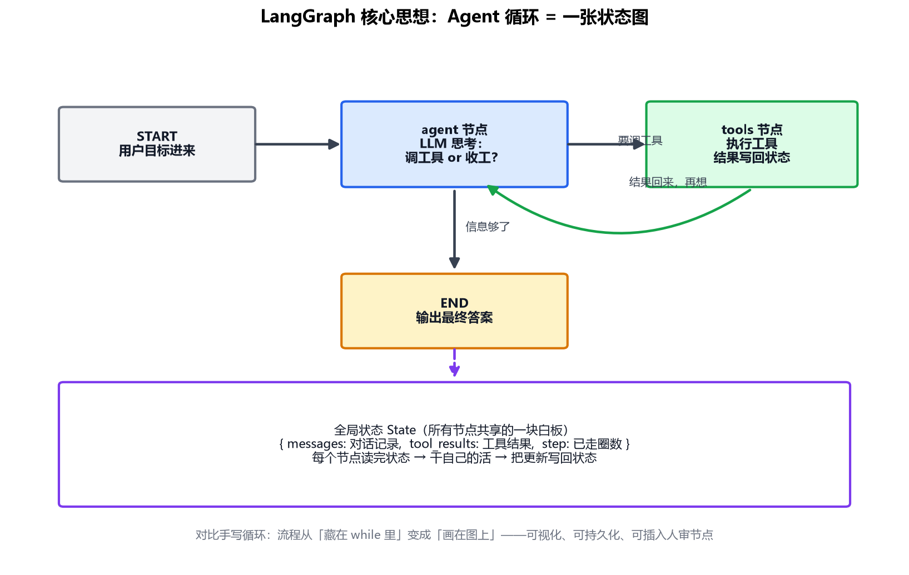

# 专题-05 - 记忆、规划与 LangGraph 状态图

## 🎯 学习目标
- 掌握短期记忆的管理术：窗口满了怎么办（摘要、滑动窗口、取舍）
- 区分三种规划姿势：ReAct、Plan-and-Execute、Reflexion，知道各自适用场景
- 理解 LangGraph 的核心抽象：状态、节点、边，以及它相对手写循环多解决了什么
- 能把 03 篇的循环写成状态图：标准库版是必做，LangGraph 是同一张图的选做封装

---

## 📚 核心知识点

### 1. 短期记忆：上下文窗口是稀缺资源

03 篇你已经看到：Agent 的每圈循环都在往对话里追加内容——工具结果动辄几百上千 token，跑 10 圈上下文就膨胀到几万。而上下文窗口既是**稀缺资源**（超限直接报错）也是**成本大头**（token 按量计费）。

三种管理策略，按复杂度排：

**① 滑动窗口（最简单）**：只保留最近 N 轮，老的直接丢。适合闲聊型 Agent；丢掉的可能是关键信息，风险自负。

**② 摘要压缩（主流）**：对话快满时，让 LLM 把前面的历史总结成一段话，替换掉原始记录。"把 50 轮对话压成 500 字摘要"——信息有损，但核心结论保留。

**③ 选择性保留（精细）**：工具结果用完就压缩（"搜索返回了 5000 字"→ 只留模型当时引用的两段），决策性内容（计划、结论）永久保留。

> 联系你学过的：这和 RNN 的困境神似——隐状态容量有限，信息多了必然遗忘。LLM 时代的答案不是更大的窗口，而是**主动管理**（05 篇）+ **外部存储**（04 篇 RAG）。

### 2. 长期记忆：写什么、何时写、何时读

04 篇的 RAG 解决了"怎么存怎么查"，还剩两个设计问题：

- **何时写入**：每次对话结束自动存（噪音多）？还是让模型自己判断"这条值得记住"（主流）？——把"写记忆"也做成一个工具，模型说"用户对花生过敏，记下来"才写
- **何时读取**：每轮都检索（贵）？还是识别到相关话题才检索？——同样交给模型判断，或按会话开始一次性加载用户画像

原则：**记忆不是日志，是资产**——写入要挑剔，读取要精准。

### 3. 规划三种姿势（01 篇提过，这里展开）

**姿势一：ReAct 边想边做（已学）**
想一步做一步，灵活应对意外。缺点：没有全局计划，容易"低头走路"——步骤多了可能偏离目标。适合：步骤少、路径不确定的任务。

**姿势二：Plan-and-Execute 先谋后动**
先让模型一次性产出完整计划（步骤列表），再逐步执行，执行中可微调：

```
计划：1. 查明天日期 → 2. 搜北京到上海航班 → 3. 按价格排序 → 4. 订最便宜那班
执行：逐步走，每步结果写回；某步失败 → 只重规划那一步
```
优点：有全局观、进度可见。缺点：计划赶不上变化时要重规划。适合：步骤多、结构清晰的任务（写报告、数据分析）。

**姿势三：Reflexion 反思（最贵但最强）**
任务失败后，让模型复盘："刚才哪步走错了？下次怎么改？"把反思写进记忆再试一遍。等于给 Agent 加了"从失败学习"的能力——注意这和 RL 的"从奖励学习"不同：它靠的是**语言层面的自我批评**，不碰参数。

### 4. 为什么需要 LangGraph：手写循环的天花板

03 篇的 while 循环够教原理，但生产需求会把它撑破：

- 想在循环中间**插入人工确认**（"要发邮件了，等人点头"）——while 里塞 input() 很丑，进程还得一直挂着
- 想**崩溃后从断点恢复**——内存里的 messages 进程一没全丢
- 想**看清 Agent 走了哪条路**——print 日志追多分支流程是灾难

LangGraph 的答案：**把循环画成一张状态图**。

### 5. LangGraph 核心抽象：State / Node / Edge



三个概念就够入门：

- **State（状态）**：所有节点共享的一块白板，一个 TypedDict——`{messages, tool_results, step}`。节点之间不传参数，都读写这块白板
- **Node（节点）**：一个普通 Python 函数，输入是 State，输出是"对 State 的更新"。`agent` 节点调 LLM，`tools` 节点执行工具
- **Edge（边）**：节点间的跳转规则。普通边是固定跳转；**条件边**看状态决定去哪——03 篇的 `if resp.is_final_answer` 在这里变成一条条件边

把 03 篇循环翻译成图（代码骨架）：

```python
from langgraph.graph import StateGraph, END

graph = StateGraph(AgentState)              # AgentState 是个 TypedDict
graph.add_node("agent", agent_node)         # LLM 思考
graph.add_node("tools", tools_node)         # 执行工具
graph.set_entry_point("agent")
graph.add_conditional_edges("agent",        # 条件边：思考完去哪？
    lambda s: "tools" if s["pending_tool_call"] else END)
graph.add_edge("tools", "agent")            # 工具执行完，回到思考
app = graph.compile(checkpointer=MemorySaver())  # checkpointer = 状态持久化
```

和手写版逐行对应，但你立刻多得到三样东西：

- **checkpointer**：每一步自动存盘，崩溃后从断点继续（`thread_id` 一给，状态找回）
- **人审节点**：在两个节点之间插一个"等人工确认"节点，天然支持 interrupt
- **可视化与 trace**：图结构可以直接画出来、每步状态可回放

**一句话：LangGraph 不是另一个 Agent 框架，是把"你手写的循环"变成"可持久化、可观测、可干预的图"。**

### 6. 什么时候别用 LangGraph

诚实一点：简单场景（单轮问答、固定两三步的 workflow）用它是杀鸡用牛刀——01 篇的自主性光谱同样适用于框架选择：**能函数调用链解决的别上图，能单 Agent 的别上多智能体**。

### 7. 压缩要留下能接着干的四行

摘要如果写成散文，下一步还是会迷路。压完至少留这四行：

```text
目标：算特斯拉营收同比
已确认：本季 255 亿美元；去年同期 249 亿美元
不要再做：不要重复刚才那次 search
未完成：调用 calculator，表达式 (255-249)/249*100
```

被丢掉的是搜索结果原文和「我先查一下」这种中间句。08 篇把「这一轮还该放什么」补全。

### 8. 子任务只交回结论

开一个子 Agent 时，它用自己的新上下文去搜索。交回来的是结论，不是它的全部 `messages`。`practice/agent05_pipeline.py` 里，研究员自己的上下文约 820 字，写手收到的结论约 151 字；整段转交大约 5.6 倍。多出来的那些字会占用写手的窗口，也会把检索原文里可能藏着的指令带过去。

### 9. 不安装 LangGraph，先把图跑起来

`practice/agent04_state_graph.py` 用标准库写了 State、Node、条件边和按 `thread_id` 存盘。它打印的顺序就是：agent 决定 search → tools 写入营收 → agent 决定 calculator → tools 写入涨幅 → agent 给出 2.41%。

同一份脚本里还有两件框架图才方便做的事：发邮件的节点在 `send` 之前停住，等人把 `approved` 设为真再续；另一条线只存到「下一步是 tools」，再从断点跑完。

以后 `pip install langgraph`，把这里的 `agent_node` / `tools_node` 填进 05 篇第 5 节那个官方骨架即可。节点里的业务不用重写。官方还有持久化到磁盘、画图和更多中断语义，那是框架多出来的工程，不是另一套原理。

---

## 🔬 原理

### 上下文才是状态；KV cache 不是记忆

一次前向传播里，Transformer 没有 RNN 那种跨时间的隐藏状态 \(h_t\)。你在序列模型里学过：RNN 把历史压进 \(h_t\) 再传给下一步。LLM 推理时，历史必须作为 token 出现在这次输入里，注意力才能看见。

工程上的 **KV cache** 容易被说成记忆。它存的是前面 token 已经算好的 Key 和 Value，下一次生成新 token 时不必把这些矩阵重算一遍。缓存的内容和「文本里有哪些 token」一一对应。你从文本里丢掉一段，对应的 K、V 也要丢掉，模型不会在缓存里另留一份「意思」。缓存是加速，不是第二块大脑。

因此 Agent 的状态设计可以写成一句：下一步的分布只条件在你决定留下的那些 token 上。摘要、滑动窗口、选择性保留，都是在选一个更短的 token 集合，希望它对于「下一步该做什么」仍然够用。用强化学习的话说，这个集合最好保持马尔可夫：给定它，再早的原始记录不再提供额外信息。摘要若丢掉「未完成的那一步」，马尔可夫性就破了，策略条件在一个不充分的状态上，就会重复已经做过的搜索，或者忘了目标。

窗口变长并不能取消这个选择。标准自注意力里，序列长度为 \(n\) 时，一次前向的注意力计算量大约随 \(n^2\) 增长，存下来的 K、V 随 \(n\) 增长。多出来的 token 还会参与 softmax，权重和为 1，不相关的 token 分走相关 token 的权重。08 篇把这件事单独写成上下文取舍。

### 开环计划、短视闭环、用文字充当的「梯度」

三种规划对应三种信息结构：

**Plan-and-Execute 的第一稿是开环。** 计划在任何测量之前就生成完。它的好处是你能在执行前看见整张 \(n\) 步的清单，对照 01 篇的 \(p^n\) 决定要不要把某些步改成固定流程。它的失败是：第 2 步的测量和计划矛盾时，第 3、4 步仍按旧条件生成的清单走。所以可用的 Plan-and-Execute 一定带重规划——某步失败后，用新的测量重写剩余步骤。那一下重新把环闭上。

**ReAct 是闭环，但是短视的。** 每一步的分布只被训练和 Prompt 推向「现在这一下看起来合理」，没有一个显式的量在估计「这一下对十步之后的目标值多少」。步骤一多，它会在局部上一直做合理的小事，整体偏离目标。这和贪心搜索一样：每步取当前最高分，不保证全局路径。

**Reflexion 不更新参数。** 失败之后让模型写出「哪一步错了」。这段文字进入下一次尝试的 \(x\)，于是 \(p(\text{动作}\mid x)\) 变了。它看起来像从失败里学习，机制上仍是 02 篇那句话：条件变了，分布才动。反思如果只写「下次注意一点」，新 token 的特征太弱，概率质量几乎不搬家，第二次会重复第一次的路径。反思要写到「不要再调用哪一个工具、改用哪一个参数」，才足以把峰值从旧动作上挪走。

状态图相对手写循环多出来的，不是新的决策原理。它是把「状态、转移、停在转移前等人」变成显式对象，让开环清单、闭环分支和人审都能落在同一张图上，并且每一拍的状态可以存下来。决策仍然发生在节点里面那一次模型调用的条件分布里。

---

## 💻 实战练习（practice/agent04_state_graph.py）

```text
cd AI_Agent学习/practice
python agent04_state_graph.py
```

不安装 LangGraph。跑完你应该看到：营收任务在第三步给出「同比增长约 2.41%」；邮件任务先停在 send 之前，`sent` 还没有，确认后续跑才出现「已发送」；断点那条从 `next_node=tools` 接着跑完。

脚本里 `step > 5` 会强制结束。建议改动：把 5 改成 2，看它在算出涨幅之前停下来。改完再改回去。装了 LangGraph 之后，用第 5 节的骨架重接这两个节点，当作选做。

---

## ⚠️ 常见坑

1. 上下文只增不减——跑长任务必爆窗口，摘要压缩是必修课
2. 记忆写成流水账——什么都存等于什么都没存，检索时全是噪音
3. 所有任务都 ReAct——步骤多的任务没有全局计划会走丢，该 Plan-and-Execute 就换
4. 把 LangGraph 当黑盒——节点函数里照样写 03 篇那些护栏（超时、错误回灌）
5. 状态设计贪大——State 里塞几十个字段，节点间耦合到没法维护；只放节点真正需要共享的

---

## 📝 小结

- 短期记忆三策略：滑动窗口、摘要压缩、选择性保留——窗口是稀缺资源，要主动管理
- 长期记忆的关键设计：写入要挑剔、读取要精准，记忆是资产不是日志
- 规划三姿势：ReAct（灵活）/ Plan-and-Execute（全局观）/ Reflexion（从失败复盘）
- LangGraph = State（共享白板）+ Node（读改写函数）+ Edge（跳转规则），换来持久化、人审、可观测
- 下一步：专题-06，一个 Agent 不够用时——多智能体协作与 MCP 生态

---

## 💬 自学问答

**问：滑动窗口和摘要，先学哪个？**
先用滑动窗口把程序跑通。发现它会忘掉任务目标之后，再换成「目标 + 已确认 + 未完成」那种摘要。不要第一步就上摘要，摘要本身也要调。

**问：没有 LangGraph，人审怎么做？**
练习里的做法就是：发现下一个节点是 send，并且还没批准，就把状态存下来返回。人改完 `approved`，用同一个 `thread_id` 再调用。框架把这件事做成了 interrupt，原理相同。

**问：Plan-and-Execute 的计划存在哪？**
存在 State 里，例如 `plan: [...]` 和 `cursor: 0`。不要只写在模型的一句自然语言里，否则下一步无法判断走到哪了。

---

## 📝 小测验

1. 为什么「把前面聊了什么总结一下」这种摘要不够用？
2. 子 Agent 为什么不能把自己的全部消息交回父 Agent？
3. 条件边 `step > 5 → END` 是在防什么？
4. KV cache 为什么不能代替摘要？缓存里到底有什么？

### 参考答案

1. 散文摘要常常丢掉「还没做的那一步」和「不要重复的那一步」。下一步的条件里没有这些事实，分布就无法接着执行。状态不再是马尔可夫的。
2. 父 Agent 的窗口会被检索原文占满，原文里也可能夹着不该执行的指令。交回结论即可。练习里整段转交大约是结论的 5.6 倍长。
3. 防 \(p^n\) 已经很小还继续烧。它不保证答案正确，只保证不会无限跑下去。
4. 缓存里是已生成 token 的 Key 和 Value，为了少算矩阵。文本里删掉的 token，缓存里也不再保留一份意义。下一步能条件到的，仍然只是你留在文本中的那些 token。摘要负责决定留哪些 token，缓存负责把留下的算得快一点。

## 💬 我的疑问（自学时填）

| 日期 | 疑问 | 我后来怎么理解的 |
|---|---|---|
| | | |
