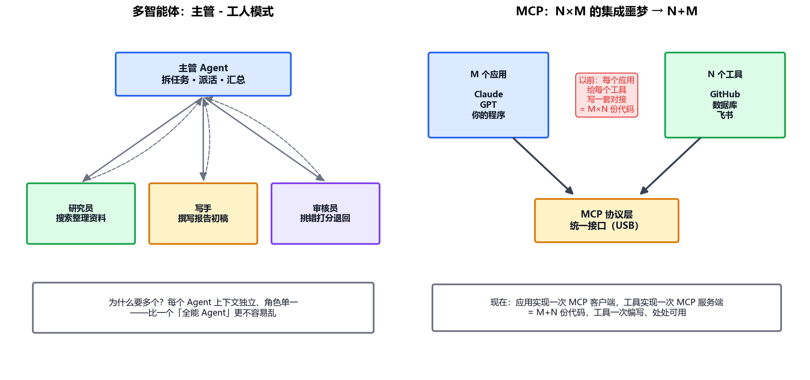

# 专题-06 - 多智能体协作与 MCP 生态

## 🎯 学习目标
- 说清什么时候才需要多智能体（以及什么时候纯属过度设计）
- 掌握三种协作模式：流水线、主管-工人、群聊辩论
- 上手 CrewAI 的三个核心概念：Agent / Task / Crew
- 理解 MCP 协议解决的问题、架构和工具发现机制
- 建立协议层世界观：MCP（工具）与 A2A（Agent 间）的分工

---

## 📚 核心知识点

### 1. 什么时候需要多个 Agent？

一个 Agent 到底哪里不够用？三个真实理由：

- **上下文隔离**：一个 Agent 干所有事，上下文里混着研究资料、写作草稿、审核意见，几万 token 互相干扰。拆开后每个 Agent 的上下文**小而专**——复习 05 篇：上下文是稀缺资源
- **角色专精**：给"研究员"和"审核员"写不同的 system prompt，各配不同的工具，比给一个 Agent 写"你既要研究又要写作还要自我批评"效果好——人格分裂的 Prompt 谁写谁知道
- **并行加速**：三个研究员同时查三个方向，比一个一个查快三倍

但记住 01 篇的光谱原则：**多智能体是最后的手段，不是默认选项**。每加一个 Agent，就多一份通信成本、调试难度和"三个和尚没水吃"的风险。单 Agent + 好工具能解决 80% 的场景。

### 2. 三种协作模式



**① 流水线（Pipeline）**：A 的输出是 B 的输入，固定顺序。研究员 → 写手 → 审核员，各干一段。本质是 01 篇说的 workflow——可控性最强，最推荐起步。

**② 主管-工人（Supervisor / Hierarchical）**：一个主管 Agent 负责拆任务、派活、验收、汇总；工人 Agent 各管一摊。主管可以动态决定"这份资料不够，让研究员再查一轮"——灵活度上一档，对应图左。

**③ 群聊辩论（Group Chat / Debate）**：多个 Agent 围着一个话题轮流发言，靠讨论收敛出答案（AutoGen 的招牌模式）。适合开放式探索（头脑风暴、方案评审），但轮次和成本最不可控。

### 3. CrewAI 上手：三个概念

CrewAI 是多智能体框架里上手最快的——概念直接映射人类团队：

```python
from crewai import Agent, Task, Crew

researcher = Agent(          # ① Agent = 员工：角色 + 目标 + 工具
    role="行业研究员",
    goal="收集 {topic} 的最新动态，给出带数据的事实",
    tools=[search_tool],
    backstory="十年咨询行业经验，擅长快速调研",   # 人设定得越具体，输出越稳
)
writer = Agent(
    role="报告写手",
    goal="把研究素材写成结构清晰的 2000 字报告",
)

task1 = Task(                # ② Task = 派工单：做什么 + 谁做 + 交付什么
    description="调研 {topic} 的 2026 年现状",
    agent=researcher,
    expected_output="5 条带数据的核心发现",
)
task2 = Task(
    description="基于研究发现写报告",
    agent=writer,
    expected_output="2000 字中文报告",
    context=[task1],         # 声明依赖：写手能拿到研究员的产出
)

crew = Crew(agents=[researcher, writer], tasks=[task1, task2])  # ③ Crew = 团队
result = crew.kickoff(inputs={"topic": "AI Agent 开发"})
```

对照你在 02~03 篇学的：`role + goal + backstory` 就是角色设定（零件①），`expected_output` 就是输出格式约定（零件⑤），`context` 就是上下文传递（零件③）——**框架没有新魔法，全是旧原理的封装**。

### 4. MCP：工具集成的"USB 标准"

**要解决的问题**：M 个应用（Claude、GPT、你的程序……）× N 个工具（GitHub、数据库、飞书……）。没有标准时，每个应用要为每个工具写一套对接代码——M×N 份，生态根本长不起来。

**MCP（Model Context Protocol，Anthropic 2024 底发布）的方案**：定义一个统一协议，应用侧实现一次"MCP 客户端"，工具侧实现一次"MCP 服务端"——**M+N 份代码，任意组合即插即用**（图右）。2025 年起 OpenAI、Google 相继支持，事实上成了行业标准。

**架构三个角色**：

- **Host（宿主）**：用户直接用的应用（如 Kimi Work、Claude Desktop），里面跑 LLM
- **Client（客户端）**：宿主里的连接器，一个 Client 对一个 Server 保持会话
- **Server（服务端）**：工具的提供方，声明"我有哪些工具、资源、提示词模板"

**工作流程**（对照 03 篇你会发现全是熟面孔）：

1. 启动时 Host 问 Server：`list_tools`——拿回工具清单（就是 JSON Schema！）
2. 清单拼进给模型的上下文，模型按 03 篇的机制决定调用
3. Host 把调用转发给 Server 执行，结果回灌给模型

通信方式两种：`stdio`（本地，Server 作为子进程，开发常用）和 `HTTP/SSE`（远程服务）。安全模型也因此清晰：**Server 是独立进程，权限可以单独管控**——又一次印证"执行权在程序手里"。

### 5. A2A：Agent 之间的"MCP"

MCP 解决"模型 ↔ 工具"，那"Agent ↔ Agent"呢？Google 2025 年推出的 **A2A（Agent-to-Agent）** 协议瞄准这个：Agent 互相发布"能力名片"（Agent Card，写着我会什么、怎么收费/鉴权），然后用标准消息格式协作。格局一句话：**MCP 让 Agent 长出手，A2A 让 Agent 之间能对话**——你的 Agent 未来可以直接雇别人的 Agent 干活。

### 6. 生态选型速查（2026）

| 需求 | 推荐 |
|---|---|
| 快速验证多 Agent 想法 | CrewAI（本篇示例） |
| 复杂流程、要人审、要断点恢复 | LangGraph（05 篇） |
| 纯研究探索、Agent 间自由讨论 | AutoGen |
| 接现成工具生态 | 任何支持 MCP 的框架 + 官方 MCP Server 仓库 |
| 低代码快速上线 | Coze / Dify（平台层，原理全是本课程讲的） |

---

## 💻 实战练习（agent05_crew.py）

需要 `pip install crewai`（联网装一次）+ 一个真模型 API key（DeepSeek/通义均可）：
- 按本篇示例搭"研究员 + 写手"双 Agent 流水线，调研"AI Agent 开发"
- 观察 task1 的产出怎么通过 context 流进 task2
- 进阶：把 researcher 的 search_tool 换成一个本地 MCP Server 提供的工具，体验"USB 即插即用"

---

## ⚠️ 常见坑

1. 一上来就拆五个 Agent——通信成本爆炸，先从单 Agent + 工具开始，痛了再拆
2. Agent 之间互相传整段上下文——只传对方需要的结论，别转述全部历史
3. 群聊模式不设最大轮次——两个 Agent 能互相客气到天荒地老，token 烧穿
4. 以为 MCP 是框架——它是协议；框架（LangGraph/CrewAI）和 MCP 是互补不是竞争
5. 给 Agent 配工具不设权限——能读数据库的 Agent 也可能删数据库（07 篇讲护栏）

---

## 📝 小结

- 多智能体的三个真实理由：上下文隔离、角色专精、并行加速；但它是最后手段
- 协作三模式：流水线（可控）→ 主管-工人（灵活）→ 群聊辩论（开放，最贵）
- CrewAI 三概念：Agent（员工）/ Task（派工单）/ Crew（团队），全是 02~03 篇原理的封装
- MCP = 工具集成的 USB：M×N → M+N，Host/Client/Server 三角色，工具发现就是 03 篇的 Schema
- 格局：MCP 管"Agent 与工具"，A2A 管"Agent 与 Agent"
- 下一步：专题-07 收官，评测、安全护栏与上线，以及毕业项目
