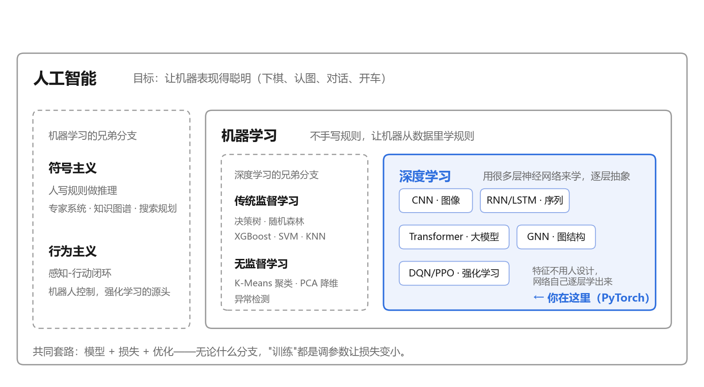

# 00-1 - 机器学习与深度学习是什么

## 🎯 学习目标

* 说清楚人工智能、机器学习、深度学习三者的关系

* 理解"从数据里学规则"和"人写规则"的区别

* 知道监督学习、无监督学习、强化学习各自解决什么问题

* 理解为什么"深"的网络比浅的强

***

## 📚 核心知识点

### 1. 三个词的关系



* **人工智能**是目标：下棋、认图、对话、开车。

* **机器学习**是一种实现方式：给例子，让程序自己总结规律。

* **深度学习**是机器学习里目前最强的一类方法：用层层叠起来的神经网络。

### 2. 人写规则 vs 从数据学规则

想让电脑识别猫：

| <br /> | 传统编程                  | 机器学习               |
| ------ | --------------------- | ------------------ |
| 做法     | 人写"有尖耳朵、有胡须、眼睛竖瞳…就是猫" | 给 10 万张标好"猫/不是猫"的图 |
| 谁出规则   | 程序员                   | 模型自己从例子里总结         |
| 难点     | 规则写不完，换个角度就失效         | 需要大量数据和算力          |

图像、语音、语言这类问题，规则多到人根本写不出来，这就是机器学习赢的地方。

### 3. 机器学习的三大类

| 类型    | 给机器的信息      | 学什么          | 例子        |
| ----- | ----------- | ------------ | --------- |
| 监督学习  | 题目 + 标准答案   | 输入 → 答案 的映射  | 看图识猫、房价预测 |
| 无监督学习 | 只有题目，没答案    | 数据里自带的结构     | 用户分群、异常检测 |
| 强化学习  | 没有答案，只有事后打分 | 怎么行动才能长期得分最高 | 下棋、游戏、机器人 |

一句话区分：**监督学习有老师批改每道题；强化学习只有一个记分牌，做完才知道好不好。**

### 4. 所有机器学习都是同一个套路

不管模型多复杂，本质都是三步：

1. **定一个带参数的函数**（模型）：参数一开始是随机的。
2. **定一把尺子**（损失函数）：衡量模型现在错得有多离谱。
3. **调参数让尺子读数变小**（优化）：一点点改，直到错得最少。

"训练模型" = 第 3 步重复成千上万次。

### -

```
原始像素 → 边缘 → 线条/角 → 眼睛、耳朵 → 猫脸 → "是猫"
  第1层      第2层      第3层        第4层      输出
```

浅层学零件，深层把零件拼成概念。这种**逐层抽象**是深度网络强大的原因，也是"深"字的由来。

### 6. 深度学习为什么最近十几年才爆发

神经网络的想法 1950 年代就有了，真正起飞是 2012 年前后。三个条件同时到位：

* **数据**：互联网带来海量标注图片、文本（如 ImageNet 一千多万张图）。

* **算力**：GPU 能并行做大量矩阵乘法，训练速度快了几十上百倍。

* **算法**：ReLU、更好的初始化、Dropout 等技巧，让深层网络训得动。

2012 年 AlexNet 在图像识别比赛上大幅领先传统方法，被看作深度学习时代的起点。

***

## 🎬 科普视频（中文）

* **3Blue1Brown《神经网络的结构》**（约 19 分钟，官方双语字幕，动画讲神经网络到底是什么）
  <https://www.bilibili.com/video/BV1bx411M7Zx/>

***

## 📝 小结

* 深度学习 ⊂ 机器学习 ⊂ 人工智能

* 机器学习 = 从数据里学规则，而不是人写规则

* 三大类：监督（有答案）、无监督（无答案）、强化（只有打分）

* 万能套路：模型 + 损失 + 优化

* 下一步：00-2 神经网络是怎么"学会"的

