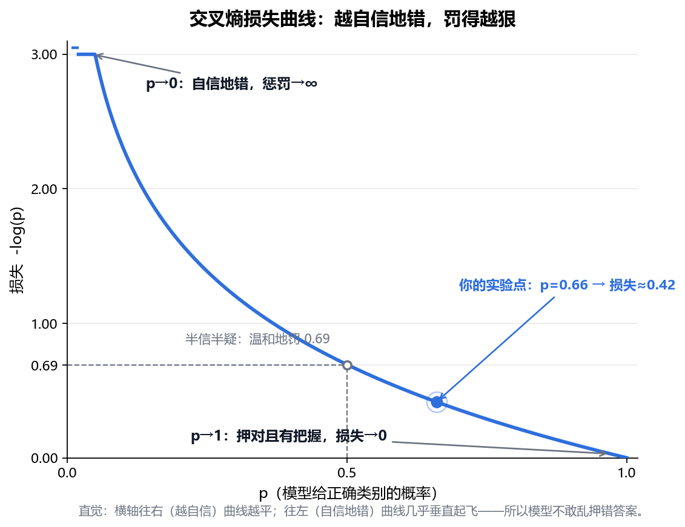
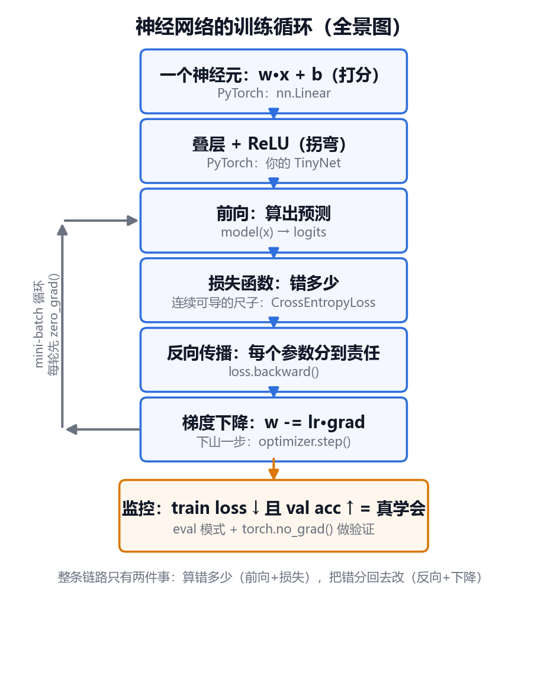

# 00-2 - 神经网络是怎么"学会"的

## 🎯 学习目标
- 理解一个神经元在做什么
- 理解为什么需要激活函数
- 用"下山"的画面理解损失函数和梯度下降
- 知道反向传播解决的是什么问题
- 理解过拟合，以及为什么要分训练集和验证集

---

## 📚 核心知识点

### 1. 一个神经元：加权打分

神经元做的事很像"综合打分"：

```
输入:  x1(有尖耳朵)  x2(有胡须)  x3(会汪汪叫)
权重:  w1 = +2        w2 = +1.5   w3 = -3
得分 = w1·x1 + w2·x2 + w3·x3 + b
```

- **权重 w**：每个特征有多重要，正数是加分，负数是扣分。
- **偏置 b**：整体门槛，得分要超过多少才算"是"。
- 权重和偏置统称**参数**。学习，就是在找一组好参数。

一个网络就是很多神经元排成层，上一层的输出当下一层的输入。大模型有几十亿到上万亿个参数，但每个参数的角色都是这么简单。

### 2. 激活函数：让网络能"拐弯"

只做加权求和，叠多少层都等于一层，因为直线套直线还是直线，只能画直的分界线。

激活函数在每层后面加一个"非线性"的处理，最常用的 **ReLU**：

```
ReLU(x) = max(0, x)     负数变 0，正数原样
```

有了这个"折一下"，层层叠加后就能拼出任意弯曲的形状，网络才能分开那些不能用一条直线切开的数据。

### 3. 损失函数：一把衡量"错多少"的尺子

模型给出预测，和标准答案比一比，差距收成一个数：

- 预测房价 300 万，实际 320 万 → 损失看差了多少
- 判断是猫的概率 0.1，实际是猫 → 损失很大
- 判断是猫的概率 0.95，实际是猫 → 损失接近 0

**训练的唯一目标：让损失尽量小。**

### 4. 梯度下降：蒙着眼下山

把所有参数可能的取值想象成一片山地，海拔就是损失。你站在某个随机位置（随机初始参数），想走到谷底（损失最小），但蒙着眼睛，看不到全貌。

能做的只有：

1. 用脚感受一下**哪个方向最陡地往下**（这个方向叫**梯度**）
2. 往那个方向迈一步
3. 重复

```
       *  ← 起点（随机参数，损失大）
        \
         \  每一步都朝最陡的下坡走
          \_
            \__
               \___*  ← 谷底（参数好，损失小）
```

**学习率**就是每一步迈多大：

- 太小：走得稳，但要走很久
- 太大：一步跨过谷底，冲到对面山坡上，越跳越高，训练崩掉
- 合适：快速又稳定地下到谷底

真实网络有几百万个参数，就是在几百万维的山里下山，原理完全一样。

### 5. 反向传播：一次算出每个参数该怎么改

难点在于：参数有几百万个，怎么知道**每一个**该往哪边调、调多少？

反向传播的思路是"追责"：

1. 从最后的损失出发，先看输出层：哪些神经元导致了这次的错？
2. 再往前一层：这些神经元的错，又是前面哪些连接造成的？
3. 一层层往回推，每个参数都分到自己该负的那份责任。

这样只需要往回走一遍，就能同时得到所有参数的调整方向。没有它，几百万个参数挨个试，根本算不完。

### 6. 小批量（mini-batch）：别等看完所有题再改

数据有几十万条，每看完全部数据才走一步太慢。实际做法是每次随机抽一小批（比如 32 条），用这一小批估计下山方向，马上走一步。

方向略有误差，但走得快，总体还是往山下去。这叫**随机梯度下降**。所有数据过一遍叫一个 **epoch**。

### 7. 过拟合：背答案 vs 真学会

学生有两种考高分的方式：真正理解，或者把练习题答案全背下来。后者换一套新题就露馅。

模型也一样：

| | 训练集表现 | 新数据表现 | 说明 |
|---|-----------|-----------|------|
| 欠拟合 | 差 | 差 | 模型太简单，没学会 |
| 刚好 | 好 | 好 | 真学会了规律 |
| 过拟合 | 很好 | 差 | 把训练数据死记硬背了 |

所以数据要分开：

- **训练集**：用来调参数（练习题）
- **验证集**：训练时不碰，用来检查有没有真学会（模拟考）
- **测试集**：最后只用一次，报告最终成绩（高考）

### 8. 不同结构擅长不同数据

| 结构 | 擅长 | 核心想法 |
|------|------|----------|
| 全连接网络（MLP） | 表格数据 | 每个输入连到每个神经元 |
| 卷积网络（CNN） | 图像 | 用小窗口在图上滑动找局部特征 |
| 循环网络（RNN/LSTM） | 序列 | 一边读一边记住前面的内容 |
| Transformer | 文本、几乎所有 | 让每个位置直接"关注"其他所有位置 |

现在的 ChatGPT 等大模型都基于 Transformer。

---

## 💬 课堂问答补充

### Q：什么是交叉熵？

交叉熵是分类问题里最常用的损失函数，衡量"模型预测的概率分布"和"标准答案"之间的差距。

**从公式到直觉**：分类题的标准答案可以写成 one-hot（正确答案那一类是 1，其余是 0），这时交叉熵公式会退化成非常简单的一个式子：

```
损失 = -log(p)
p = 模型分给「正确答案」那一类的概率
```

也就是说，交叉熵只看一件事：**你给正确答案押了多少把握**。

**为什么取 -log**：p 是 0~1 之间的小数，直接当惩罚不好用。-log 把它变成一把 0 到 ∞ 的尺子，而且样本之间的"连乘概率"变成"连加损失"，求导友好。



曲线上的三个关键位置：

| p（给正确答案的概率） | 损失 | 含义 |
|---|---|---|
| → 0 | → ∞ | 自信地错，惩罚爆炸——模型最怕这个 |
| 0.5 | 0.69 | 半信半疑，温和地罚 |
| → 1 | → 0 | 押对且有把握，几乎不罚 |

注意曲线形状：右半边很平，左半边几乎垂直起飞。**"从 0.9 提到 0.99"减的损失，远不如"从 0.01 提到 0.1"减的多**——所以训练天然逼着模型先纠正那些"自信的错误"。

**PyTorch 里的样子**：`nn.CrossEntropyLoss` 内部 = `LogSoftmax + NLLLoss`，直接吃模型输出的原始分数（logits），不需要先手动 softmax：

```python
loss_fn = nn.CrossEntropyLoss()
logits = model(x)            # 原始分数，没归一化
loss = loss_fn(logits, y)    # y 是类别编号，如 tensor([3])
```

手算验证：正确答案概率 p=0.66 时，损失 = -ln(0.66) ≈ 0.42，就落在曲线中段偏右的位置。

---

## 🎬 科普视频（中文）

按顺序看，都是 3Blue1Brown 官方双语字幕：

- **第 2 集《梯度下降，神经网络如何学习》**（约 20 分钟）
  https://www.bilibili.com/video/BV1Ux411j7ri/
- **第 3 集《反向传播算法》**（上篇讲直觉，下篇是微积分，下篇可以先跳过）
  https://www.bilibili.com/video/BV16x411V7Qg/
- **第 5 集《GPT 是什么？直观解释 Transformer》**（想知道大模型怎么来的再看）
  https://www.bilibili.com/video/BV13z421U7cs/

---

## 📝 小结

把整条训练链路画成一张图，每个环节都对应你写过的 PyTorch 代码：



- 神经元 = 加权打分；参数 = 权重 + 偏置
- 激活函数让网络能拐弯，没有它多层等于一层
- 训练 = 蒙眼下山：损失是海拔，梯度是坡向，学习率是步长
- 反向传播 = 从错误往回追责，一次算出所有参数的调整方向
- 训练集上好不算数，验证集上好才是真学会
- 下一步：00-3 什么是强化学习
