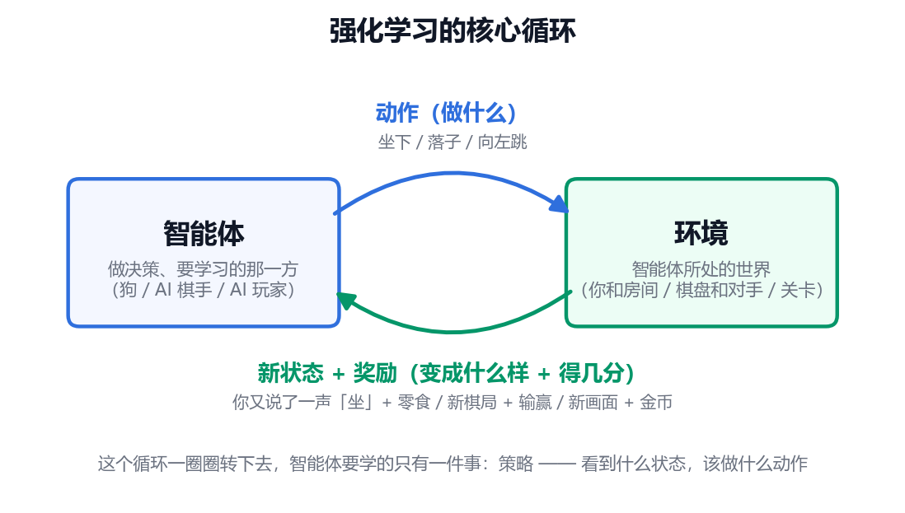

# 00-3 - 什么是强化学习

## 🎯 学习目标
- 用生活例子理解强化学习的基本思想
- 认识智能体、环境、状态、动作、奖励这几个角色
- 理解"延迟奖励"和"探索与利用"这两个核心难题
- 知道强化学习和深度学习怎么结合，以及 AlphaGo 等代表成果

---

## 📚 核心知识点

### 1. 先看一个生活例子：训狗

你想教狗坐下：

- 你说"坐"，狗乱动 → 没奖励
- 狗碰巧坐下了 → 给块零食
- 重复几十次，狗发现"听到'坐'就坐下 = 有零食"

你**从来没告诉狗正确动作是什么**，只在它做对时给奖励。狗靠自己试错，摸索出了得到奖励的行为。

**这就是强化学习：没有标准答案，只有奖励，在不断尝试中学会怎么做。**

### 2. 五个角色

| 角色 | 含义 | 训狗 | 下围棋 | 玩超级马里奥 |
|------|------|------|--------|--------------|
| 智能体 | 做决策、要学习的那一方 | 狗 | AI 棋手 | AI 玩家 |
| 环境 | 智能体所处的世界 | 你和房间 | 棋盘和对手 | 游戏关卡 |
| 状态 | 当前的情况 | 你刚说了"坐" | 当前棋盘局面 | 当前游戏画面 |
| 动作 | 智能体能做的选择 | 坐、趴、跑 | 在哪落子 | 左、右、跳 |
| 奖励 | 环境给的分数 | 零食 | 赢 +1，输 -1 | 吃金币 +，掉坑 - |

智能体要学的东西叫**策略**：看到什么状态，该做什么动作。

### 3. 和监督学习的根本区别

| | 监督学习 | 强化学习 |
|---|----------|----------|
| 反馈 | 每道题都有标准答案 | 只有奖励分数 |
| 反馈时机 | 立刻知道对错 | 常常很久以后才知道 |
| 数据从哪来 | 现成的数据集 | 自己和环境互动产生 |
| 目标 | 答对每道题 | 长期总得分最高 |
| 类比 | 有老师逐题批改作业 | 打游戏，只看最后通没通关 |

### 4. 难题一：延迟奖励

下围棋一盘两百多步，只有最后才知道输赢。赢了，是哪一步下得好？输了，是哪一步臭棋？

这叫**功劳分配问题**。强化学习要从最终结果倒推，判断前面每一步的价值。

为了处理这一点，强化学习追求的不是眼前奖励，而是**长期累计奖励**，并且远处的奖励打个折扣：今天的 100 块比一年后的 100 块更值钱。折扣让智能体既看眼前，也顾长远。

### 5. 难题二：探索与利用

你去一个新城市吃饭：

- **利用**：去已知好吃的那家，稳定，但可能错过更好的
- **探索**：试一家没去过的，可能踩雷，也可能发现宝藏

只利用，永远困在"还不错"；只探索，永远在踩雷。强化学习必须平衡两者。常见做法是：大部分时候选当前最好的，偶尔随机试一下，并且随着经验增多，逐渐减少乱试。

### 6. 价值：学会"判断局面好坏"

高手看棋盘一眼就知道"这局面我优势"。强化学习也会学这种直觉，叫**价值**：

- **状态价值**：这个局面，往后大概能拿多少分
- **动作价值**：这个局面下走这一步，往后大概能拿多少分

有了动作价值，决策就简单了：每次选价值最高的那个动作。

### 7. 两大思路

| 思路 | 学什么 | 类比 | 代表算法 |
|------|--------|------|----------|
| 基于价值 | 每个动作值多少分，选最高的 | 先给每条路打分，再挑最好的 | Q-Learning、DQN |
| 基于策略 | 直接学"该做什么" | 凭直觉直接出手，做对了就加强这种直觉 | 策略梯度、PPO |
| 两者结合 | 一个负责行动，一个负责评价 | 演员表演，评论家打分，演员据此改进 | Actor-Critic |

### 8. 深度强化学习：两者结合

早期强化学习用一张表记录"每个状态下每个动作值多少分"。但围棋局面数比宇宙原子还多，表根本存不下。

解决办法：**用神经网络代替这张表**。输入局面，网络输出各个动作的价值或概率。这就是**深度强化学习**：

- 深度学习负责"看懂"：从画面、棋盘里提取特征
- 强化学习负责"决策"：根据奖励不断改进行为

神经网络的训练方式还是梯度下降和反向传播，只是"损失"不再来自标准答案，而是来自奖励。

### 9. 代表性成果

| 时间 | 成果 | 意义 |
|------|------|------|
| 2013 | DQN 玩 Atari 游戏 | 只看屏幕像素，学会几十款游戏，部分超过人类 |
| 2016 | AlphaGo 击败李世石 | 首次在围棋上战胜世界顶尖棋手 |
| 2017 | AlphaGo Zero | 不看人类棋谱，纯自我对弈，超越所有前代 |
| 2019 | OpenAI 捉迷藏实验 | 智能体自己发明了用箱子堵门、踩箱子翻墙等策略 |
| 2022 起 | ChatGPT 的 RLHF | 用人类偏好当奖励，让大模型回答更有用、更安全 |
| 现在 | 机器人控制 | 机器狗、机械臂在模拟器里试错学走路和抓取 |

---

## 🎬 科普视频（中文）

- **《AlphaGo》纪录片**（约 90 分钟，中英双语字幕，讲 AlphaGo 对战李世石）
  https://www.bilibili.com/video/BV1gZ4y1W72Y/
- **OpenAI 捉迷藏**（约 3 分钟，中文字幕，看智能体如何靠奖励自己琢磨出策略）
  https://www.bilibili.com/video/BV1tE411Q74p/
- **《思维游戏 The Thinking Game》**（中英字幕，AlphaGo 之后的故事，讲到 AlphaFold）
  https://www.bilibili.com/video/BV14oS5B5E5i/

---

## 📝 小结

- 强化学习 = 没有标准答案，靠奖励试错学习，像训狗
- 五个角色：智能体、环境、状态、动作、奖励；要学的是策略
- 两个核心难题：延迟奖励（功劳怎么分）、探索与利用（试新还是守旧）
- 两大思路：学价值（打分再选）、学策略（直接出手）
- 深度强化学习 = 神经网络负责看懂，强化学习负责决策
- 下一步：先学 01 起的 PyTorch 实操，再进 07 强化学习看具体算法
